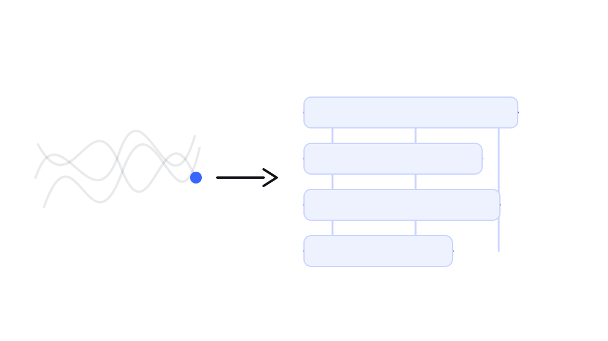

# 我怎样读一份陌生的源代码

<!--META-->

第一次打开一个陌生项目，满屏都是不认识的名字，很容易从第一个文件顺着往下读，读到一半就迷路了。我的做法反过来：先让它跑起来，再从结果往回找。

## 先让它跑起来

能运行的项目才看得懂。跑起来以后你有一个具体的画面，后面每读到一段代码，都能问自己“它在这幅画面里负责哪一块”。这一步花的时间最少，收益最大。

## 找到入口，只看一条路

一个程序通常只有一个入口，从这个入口出发，挑一条最常见的路径跟着走：点一个按钮，看它触发了什么，数据从哪儿来、到哪儿去。走通一条，剩下的多半是同一套写法的变形。

- 先看目录名字，猜每个文件夹负责什么；
- 再看入口文件调用了谁，只跟一层；
- 遇到绕的地方先记下来，别停下来钻。

## 画一张自己的图

读完一条路径就画一张图：几个方框，几条箭头，写上自己的话。别人的注释会骗人，自己画的图不会。这张图也是将来回来改代码时最省事的说明书。

> 读代码的目标不是读完，而是能在需要改动的时候，知道该动哪个文件。

## 最后才评价

看到奇怪的写法先别急着说它烂。多数奇怪的地方，背后都有一个当时不得不这么做的原因；找到那个原因，比吐槽有用得多🍒。

---

<small>标签：读代码 · 方法　|　写于 2026-02-18</small>
