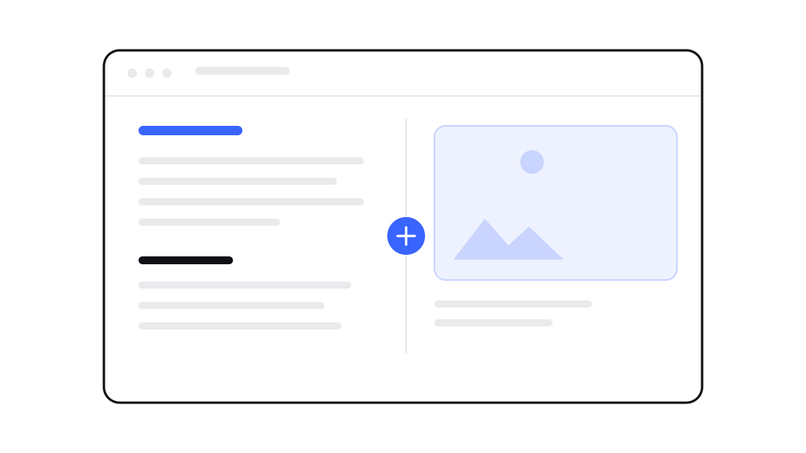

# 怎么更新博客、新增一篇日志



<!--META-->

这个站是 MkDocs 生成的，内容仍然全是普通文本文件。所以加一篇博客，既不碰模板也不碰配置，就是新建一个文件、写点字、生成一次。

## 一次新增一篇日志：三步

**第一步，新建文件。** 在 `docs/blog/` 这个文件夹里，新建一个文本文件，名字随便起，但要用英文和横线，比如 `my-first-post.md`。文件名会变成这篇日志的网址：`/blog/my-first-post/`。

**第二步，写正文。** 用记事本或任何编辑器打开它，从上到下照着这样写：

```
---
title: 我的第一篇日志
date: 2026-03-05
tag: 随笔
description: 这段是列表里显示的一句话摘要。
---

# 我的第一篇日志

## 第一个小节

正文写在这里。空一行就是新段落。

## 第二个小节

- 列表第一行
- 列表第二行
```

最上面两条 `---` 之间的几行是“登记信息”，必须留着：

- `title`：文章标题，显示在页面最上面，也用于列表页；
- `date`：日期，博客列表按它从新到旧排；
- `tag`：分类，显示在标题下方和列表里；
- `description`：一句话摘要，给搜索结果用；
- `cover`：想让文章开头有一张大图，就写 `cover: ../images/xxx.svg`（图片放在 `docs/images/` 里），不写就没有；
- `coverAlt`：大图的说明，读屏软件会念出来。

**第三步，重新生成。** 在项目根目录运行一次生成命令，几秒钟就好：

```
mkdocs build          # 生成到 site/
mkdocs serve          # 或者起一个本地服务，边写边看
```

新日志会自己出现在首页的“最新博客”、博客列表页，并且拥有自己的页面。原来的文章一篇都不用改，也不用去动任何模板。

## 在文章里放图片

单独一行写下面这样，图片就会占满正文栏的宽度，手机上也自动缩小：

```

```

方括号里是给读屏软件和搜索用的说明（必写）。图片文件放到 `docs/images/` 文件夹里，因为文章在 `docs/blog/` 下面，路径要往前退一层，写 `../images/文件名`。

## 几种常用的写法

- `## 小节标题`：一级小节，长文档靠它分段；
- 两个星号包住一句话：变成加粗；
- `- 一行`：圆点列表；
- `1. 一行`：带编号的步骤；
- `> 一句话`：引用块，左边有一条竖线，适合写注意事项；
- 三个反引号包住的代码：等宽字体、保留缩进，太长的行自己横向滚动。

## 想改软件手册那一栏

同样的做法，只是文件放在 `docs/docs/` 里，生成的页面在 `/docs/` 下面。首页上面那张“使用引导”的列表在 `docs/index.md`，每一项是一个 `??? note "问题"` 折叠块；想让某一行末尾多一个“阅读全文”链接，就在块里加一行 `[阅读全文](docs/某个页面的文件名.md)`。

## 想改颜色或版式

那叫“不该动的部分”：颜色在 `mkdocs.yml` 的 `theme.palette` 里，改一个值整站生效。日常更新博客用不到它。

---

<small>标签：维护 · 写作　|　写于 2026-03-05</small>
